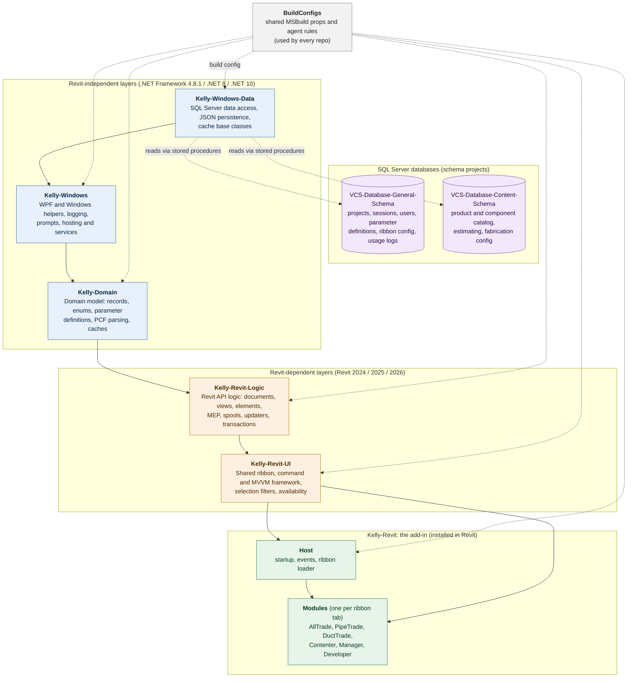

# Kelly Tools For Revit (KTR): Architecture Summary

*Prepared 2026-10-19*

## Overview

Kelly Tools For Revit (KTR) is the internal Autodesk Revit add-in suite that supports fabrication, detailing, modeling and data-driven workflows at J.H. Kelly. It is built as a **layered stack of six code repositories**, plus two database projects and a shared build-configuration repository.

Each layer is published as a NuGet package and depends only on the layers beneath it. Each layer pins the version of the layer below it exactly, so a change moves up the stack only when the layers above are repacked and rebuilt. This keeps the Revit-independent code (the bottom three layers) separate from the Revit-specific code (the top three) and the add-in itself.

## Architecture diagram

*Arrows show dependency direction: each layer builds on the one it points to. Dotted lines are data access and build configuration.*

## What each layer does

| Layer | Repository | Purpose | Contains | Depends on |
|---|---|---|---|---|
| 1 | **Kelly-Windows-Data** | The lowest layer. Revit-free data access and settings. | SQL Server access through stored procedures, atomically written JSON file storage, JSON Lines audit logs, cache base classes, connection-string handling and diagnostics. Holds no business records. | Nothing (external libraries only) |
| 2 | **Kelly-Windows** | Revit-free WPF and Windows helper layer. | Logging, file, clipboard, image and string helpers, WPF value converters, shared models and colours, the user-prompt abstraction, application-service hosting. No Revit API code and no domain model code. | Kelly-Windows-Data |
| 3 | **Kelly-Domain** | Kelly's domain model, with no Revit dependency. | Records, enums, DTOs and identifiers for connectors, fabrication, products, projects, spools, supports and parameter definitions. Also PCF parsing, layout points and the SQL-backed caches (components, products, systems, terminology). | Kelly-Windows, Kelly-Windows-Data |
| 4 | **Kelly-Revit-Logic** | The Revit API logic layer. All code that touches Revit lives from here up. | Document, view, element and MEP operations, spool and support handling, parameter handling, dynamic updaters, purges, and transaction tracking (`OperationService`). Built for Revit 2024, 2025 and 2026. | Kelly-Domain |
| 5 | **Kelly-Revit-UI** | The shared user-interface framework for every tool. | Ribbon building blocks and module loader, command and view-model base classes, shared WPF controls and styles, selection filters, scope helpers, command availability. Contains no concrete tool. | Kelly-Revit-Logic |
| 6 | **Kelly-Revit** | The add-in itself, as installed in Revit. Not a NuGet package. | A host (startup, event subscription, ribbon loading) plus one module DLL per ribbon tab: **AllTrade** (Tools), **PipeTrade** (Pipe), **DuctTrade** (Duct), **Contenter** (Content), **Manager** (Manage), **Developer**. Also the installer. | Kelly-Revit-UI and all layers below |

### Supporting repositories

| Repository | Purpose |
|---|---|
| **VCS-Database-General-Schema** | SQL Server schema project for the general database behind the add-in: projects, application and project sessions, users and roles, external parameter definitions, connector and end-preparation reference data, ribbon configuration, and operation and usage logging. |
| **VCS-Database-Content-Schema** | SQL Server schema project for **VCSContent**, the MEP product and component catalog: fabrication products, materials, estimating data and fabrication configuration. |
| **BuildConfigs** | Shared MSBuild property files and shared engineering rules imported by every layer, so all repositories build, package and version the same way. |

## How the layers work together

- **Strict one-way dependencies.** A layer may use only the layers beneath it. This keeps responsibilities separate and makes each layer testable on its own.
- **Revit isolation.** The bottom three layers have no Revit dependency. They build for .NET Framework 4.8.1, .NET 8 and .NET 10 and can be tested without Revit. Revit-specific code starts at layer 4.
- **Multi-version support.** The Revit layers and the add-in are built for Revit 2024, 2025 and 2026.
- **Modular add-in.** Each ribbon tab is its own module DLL. The host loads only the modules present, which allows tabs to be shipped or withheld independently.
- **Versioned releases.** Every layer is a NuGet package, and each layer above pins the exact version of the layer below. A change reaches users only after its package is built, the layers above are re-pinned and rebuilt, and the add-in is rebuilt and installed.
- **Quality practices.** Every repository follows test-driven development, keeps a dated changelog, and requires a test for every type member. Layers 4 to 6 are tested inside a running Revit.

## Startup at runtime

When Revit loads the add-in, the host registers the shared services that the lower layers rely on:

1. User-prompt handling.
2. Shared parameter definitions, read from a SQL Server cache.
3. Server data caches.
4. Add-in services.

It then starts each application service in order, subscribes to Revit events, and builds the ribbon from the available modules.
